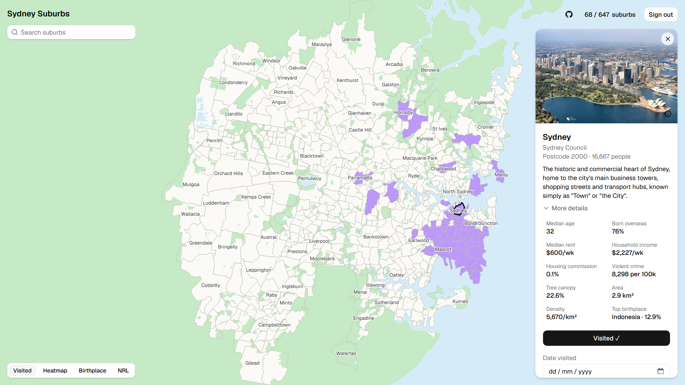
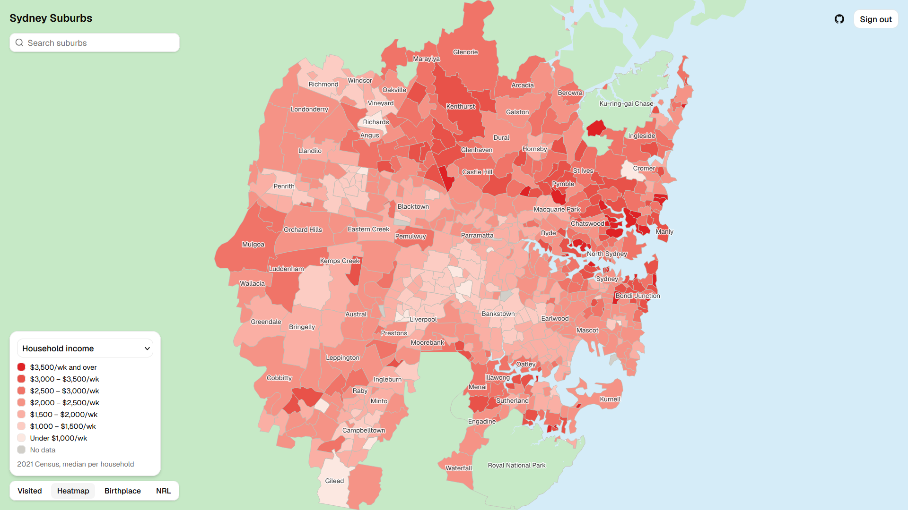
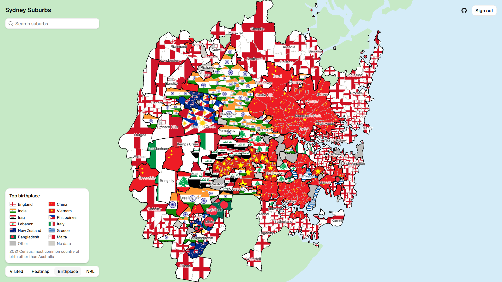
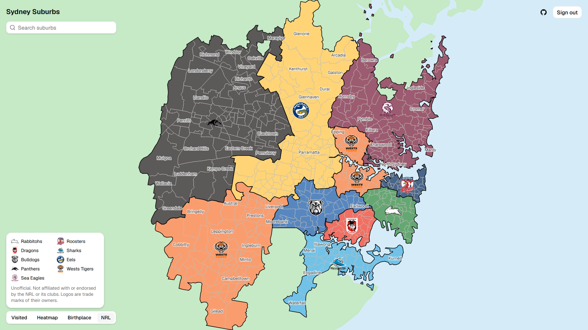

# Sydney Suburbs

- Interactive map of Greater Sydney's 648 suburbs
- Photo, summary and census stats for each suburb
- Heatmaps for income, rent, crime, tree canopy and more
- NRL club territories
- Visit progress by council
- Sign in with Google or GitHub to sync across devices

## Tech Stack

- **Frontend:** Vite, React, TypeScript, TanStack Router and Query, Tailwind CSS
- **Map:** SVG drawn with d3-geo and d3-zoom from a TopoJSON file
- **API:** Hono in a Vercel Function
- **Auth:** Better Auth with Google and GitHub sign-in
- **Database:** Neon Postgres with Drizzle ORM
- **Hosting:** Vercel

## Data

Suburb boundaries come from the ABS Australian Statistical Geography Standard (ASGS) Edition 3, licensed under [CC BY 4.0](https://creativecommons.org/licenses/by/4.0). The area is the ABS Greater Sydney region minus the Blue Mountains, Central Coast, Oberon and Wollondilly councils, national parks, and the rural fringe. Parks come from ABS Mesh Blocks, and rivers and lakes from NSW Spatial Services Hydro Area. Label priority follows the strategic centres in the NSW Greater Sydney Region Plan.

Suburb facts come from these sources:

- Population, birthplace, top overseas birthplace, medians and housing commission: ABS 2021 Census General Community Profile DataPack, tables G01, G02, G09F to G09H and G37, licensed under [CC BY 4.0](https://creativecommons.org/licenses/by/4.0)
- Violent crime: [NSW Bureau of Crime Statistics and Research](https://bocsar.nsw.gov.au) recorded crime by suburb, licensed under [CC BY 4.0](https://creativecommons.org/licenses/by/4.0)
- Tree canopy: NSW Department of Planning, Housing and Infrastructure urban tree canopy by suburb 2022, © State Government of NSW and NSW Department of Planning, Housing and Infrastructure 2023, licensed under [CC BY 4.0](https://creativecommons.org/licenses/by/4.0)
- Area and density: ABS ASGS Edition 3 Suburbs and Localities, licensed under [CC BY 4.0](https://creativecommons.org/licenses/by/4.0)
- Postcodes: ABS ASGS Edition 3 Postal Areas, licensed under [CC BY 4.0](https://creativecommons.org/licenses/by/4.0), using the postal area that covers most of each suburb
- Matching suburbs to articles and photos: [Wikidata](https://www.wikidata.org), licensed under [CC0](https://creativecommons.org/publicdomain/zero/1.0/)
- Summaries: written for this app, drawing on [Wikipedia](https://en.wikipedia.org) (CC BY-SA 4.0)
- Photos: [Wikimedia Commons](https://commons.wikimedia.org), each under its own free licence; every photo's photographer, licence and source page are listed in `src/data/suburb-facts.json` and on the website
